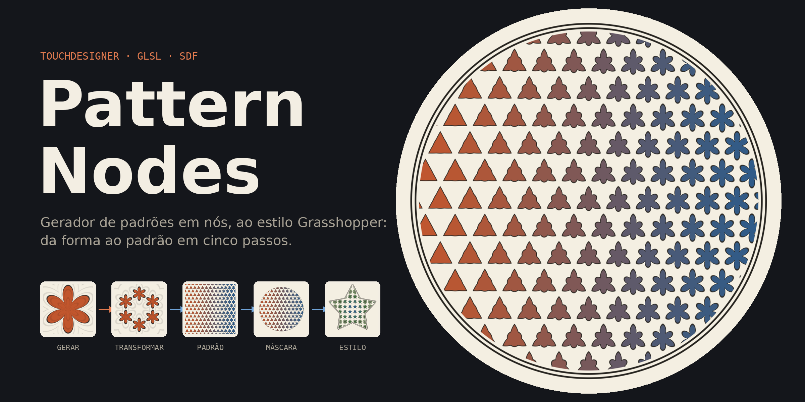

# Pattern Nodes

Gerador de padrões em nós, ao estilo Grasshopper: da forma ao padrão em cinco passos.

**Gerar → Transformar → Padrão → Máscara → Estilo**

- **Gerar** — formas básicas, natureza, geometria sagrada, ou qualquer imagem convertida em forma
- **Transformar** — escala, rotação, espelho, repetição radial; combinar duas formas
- **Padrão** — tile sem costuras (quadrado, hex, tijolo) ou metamorfose de uma forma para outra
- **Máscara** — recortar o padrão numa silhueta
- **Estilo** — cores, traço e contorno

## Ficheiros

- `Pattern Nodes.html` — a app (abrir no browser)
- `Pattern Nodes — como funciona.pdf` — apresentação
- `Cartaz A2@1x.png` — cartaz do fluxo de nós
